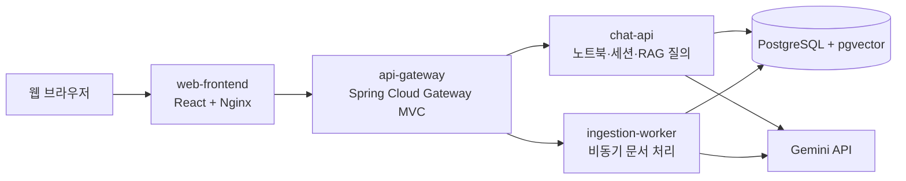

# RAG Knowledge Platform

기술 문서를 노트북별로 등록하고, 등록된 자료를 검색해 Gemini 기반 답변을 제공하는 RAG 지식 관리 서비스입니다. 노트북과 세션은 서버의 공용 작업 공간으로 관리되어, 서버에 접속한 사용자가 함께 조회하거나 삭제할 수 있습니다.

## 주요 기능

- 공용 노트북과 대화 세션 생성·조회·삭제
- 노트북에 PDF, Markdown, TXT 문서 업로드
- 업로드 작업 ID를 먼저 반환하고 처리 상태(`QUEUED`, `PROCESSING`, `COMPLETED`, `FAILED`) 조회
- 문서 청크와 임베딩을 PostgreSQL/pgvector에 저장하고, 관련 자료를 검색해 Gemini 답변과 출처 제공
- Gemini의 일시적인 `503`/`504` 및 응답 지연에 최대 3회 시도(최초 요청 포함)

문서 업로드는 기본 20 MiB까지 허용합니다. OCR, 웹 크롤링 및 외부 웹 검색 기능은 아직 구현되어 있지 않습니다.

## 구성



| 디렉토리                    | 역할                                                 |
|:------------------------|:---------------------------------------------------|
| `apps/web-frontend`     | React/TypeScript 웹 화면, 문서 업로드 및 작업 상태 표시           |
| `apps/api-gateway`      | 브라우저 API 요청을 chat-api 또는 ingestion-worker로 라우팅     |
| `apps/chat-api`         | 노트북·세션 API, 문서 검색, Gemini 답변 생성                    |
| `apps/ingestion-worker` | PDF/Markdown/TXT 파싱, 청킹, 임베딩 및 비동기 작업 관리           |
| `deployments/k8s`       | PostgreSQL StatefulSet과 애플리케이션 Kubernetes manifest |
| `docs`                  | 아키텍처, 빌드, 요구사항 및 문제 해결 문서                          |

## 기술 스택

- Java 25, Spring Boot, Spring Cloud Gateway MVC
- React, TypeScript, Vite, Nginx
- PostgreSQL 17, pgvector
- Docker 및 Kubernetes
- Gemini API

## 로컬 Kubernetes 배포

다음 절차는 프로젝트 루트에서 PowerShell로 실행하는 예시입니다. Docker Desktop Kubernetes를 사용한다면 Kubernetes가 활성화되어 있고 `kubectl`이 해당 클러스터를 가리키는지 먼저 확인하세요.

```powershell
kubectl config current-context
kubectl get nodes
```

### 1. Secret 생성

PostgreSQL 비밀번호와 Gemini API 키를 Secret으로 만듭니다. 실제 키와 비밀번호를 저장소에 커밋하지 마세요.

```powershell
kubectl create secret generic postgres-credentials `
  --from-literal=username=rag_app `
  --from-literal=password='<비밀번호>'

kubectl create secret generic gemini-credentials `
  --from-literal=api-key='<Google-AI-Studio-API-키>'
```

`gemini-credentials`는 애플리케이션 실행 자체에는 선택 사항이지만, 문서 임베딩과 Gemini 답변 생성에는 유효한 API 키가 필요합니다. 이미 Secret이 있다면 중복 생성하지 말고 기존 Secret을 사용하거나 갱신하세요.

### 2. PostgreSQL 배포

PostgreSQL은 pgvector 확장을 사용하는 StatefulSet이며 영속 볼륨을 요청합니다. 클러스터에 기본 StorageClass가 필요합니다.

```powershell
kubectl apply -f deployments/k8s/statefulsets/postgres.yaml
kubectl rollout status statefulset/postgres --timeout=180s
```

애플리케이션은 클러스터 내부의 `postgres:5432` Service를 통해 `rag_knowledge` 데이터베이스에 연결합니다.

### 3. Java 서비스 패키징

각 Java 서비스는 Docker 이미지 빌드 전에 실행 가능한 JAR가 있어야 합니다. 서비스별 명령과 설정은 다음 문서를 참고하세요.

- [API Gateway 빌드](docs/build/api_gateway_build.md)
- [Chat API 빌드](docs/build/chat_api_build.md)
- [Ingestion Worker 빌드](docs/build/ingestion_worker_build.md)

### 4. 이미지 빌드 및 애플리케이션 배포

```powershell
docker build -t finalproject/chat-api:local -f apps/chat-api/Dockerfile apps/chat-api
docker build -t finalproject/ingestion-worker:local -f apps/ingestion-worker/Dockerfile apps/ingestion-worker
docker build -t finalproject/api-gateway:local -f apps/api-gateway/Dockerfile apps/api-gateway
docker build -t finalproject/web-frontend:local -f apps/web-frontend/Dockerfile apps/web-frontend

kubectl apply -f deployments/k8s/deployments/chat-api.yaml
kubectl apply -f deployments/k8s/deployments/ingestion-worker.yaml
kubectl apply -f deployments/k8s/deployments/api-gateway.yaml
kubectl apply -f deployments/k8s/deployments/web-frontend.yaml

kubectl rollout status deployment/chat-api --timeout=180s
kubectl rollout status deployment/ingestion-worker --timeout=180s
kubectl rollout status deployment/api-gateway --timeout=180s
kubectl rollout status deployment/web-frontend --timeout=180s
```

새 이미지 빌드 후 기존 Pod가 그대로 남아 있다면 해당 Deployment를 재시작해 새 이미지를 적용하고 rollout을 확인하세요.

```powershell
kubectl rollout restart deployment/api-gateway
kubectl rollout status deployment/api-gateway --timeout=180s
```

각 서비스의 전체 이미지 갱신이 필요하면 같은 방식으로 해당 Deployment를 재시작합니다. 로컬 Kubernetes 클러스터가 Docker 이미지를 공유하지 않는 경우에는 사용하는 클러스터에 이미지를 적재하거나 클러스터가 접근할 수 있는 레지스트리에 이미지를 게시해야 합니다.

### 5. 접속

- 웹 프론트엔드: `http://localhost:30081`
- API Gateway: `http://localhost:30080`

NodePort에 호스트에서 접근할 수 없다면 포트 포워딩을 사용합니다.

```powershell
kubectl port-forward service/web-frontend 8080:8080
```

그 뒤 `http://localhost:8080`을 엽니다. Gateway API를 직접 확인할 때는 다른 터미널에서 `kubectl port-forward service/api-gateway 8081:8080`을 실행한 뒤 `http://localhost:8081`을 사용하세요.

## API 요약

프론트엔드와 API의 전체 경로는 API Gateway를 통해 호출합니다.

| 메소드      | 경로                                         | 기능                          |
|:---------|:-------------------------------------------|:----------------------------|
| `GET`    | `/api/v1/notebooks`                        | 노트북 목록 조회                   |
| `POST`   | `/api/v1/notebooks`                        | 노트북 생성                      |
| `DELETE` | `/api/v1/notebooks/{notebookId}`           | 노트북과 연결 데이터 삭제              |
| `GET`    | `/api/v1/notebooks/{notebookId}/sessions`  | 노트북 세션 목록 조회                |
| `POST`   | `/api/v1/notebooks/{notebookId}/sessions`  | 세션 생성                       |
| `GET`    | `/api/v1/sessions/{sessionId}`             | 세션 정보 조회                    |
| `POST`   | `/api/v1/sessions/{sessionId}/chat`        | 관련 문서를 검색해 질문에 답변           |
| `POST`   | `/api/v1/notebooks/{notebookId}/documents` | 문서 업로드 (`file`, 선택 `title`) |
| `GET`    | `/api/v1/ingestion-jobs/{jobId}`           | 업로드 작업 상태 조회                |

업로드는 `multipart/form-data`를 사용하며 PDF, MD, TXT 파일을 지원합니다. 업로드 응답에서 받은 `jobId`로 상태 조회 API를 호출해 처리가 끝날 때까지 확인합니다. 자세한 요청 예시는 [Ingestion Worker 빌드 및 API 안내](docs/build/ingestion_worker_build.md)를 참고하세요.

## 프론트엔드 개발 서버

Kubernetes에서 Gateway를 포트 포워딩한 뒤 Vite 개발 서버를 실행할 수 있습니다.

```powershell
kubectl port-forward service/api-gateway 8080:8080
```

```powershell
cd apps/web-frontend
npm.cmd ci
npm.cmd run dev
```

Vite가 출력한 주소(기본 `http://localhost:5173`)로 접속합니다. 프론트엔드 개발 및 이미지 빌드 안내는 [Web Frontend 문서](docs/build/web_frontend_build.md)를 참고하세요.

## 로그 및 문제 확인

```powershell
kubectl get pods
kubectl get services
kubectl logs deployment/api-gateway --tail=100
kubectl logs deployment/chat-api --tail=100
kubectl logs deployment/ingestion-worker --tail=100
kubectl logs deployment/web-frontend --tail=100
```

`kubectl describe pod <pod-name>`은 시작 실패, 이미지 pull 문제, Secret 누락, probe 실패를 확인할 때 사용합니다. Kubernetes에 배포된 각 애플리케이션은 `kubectl logs`로 개별 확인합니다.

## 문서

- [요구사항 분석](docs/requirements_analysis/usecase.md)
- [주제 및 배경](docs/requirements_analysis/subject.md)
- [전체 아키텍처](docs/architecture/architecture_root.txt)
- [데이터 흐름 다이어그램](docs/architecture/dataflow.drawio)
- [Kubernetes 배포 안내](deployments/k8s/README.md)
- [빌드 사전 준비](docs/build/prerequisites_for_build.md)
